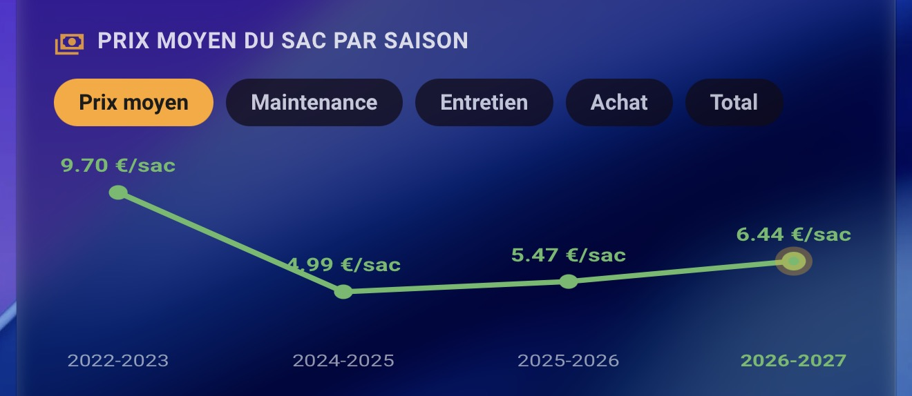
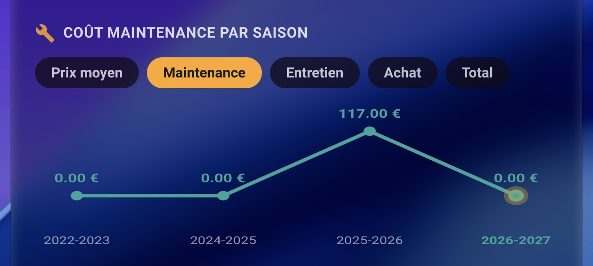
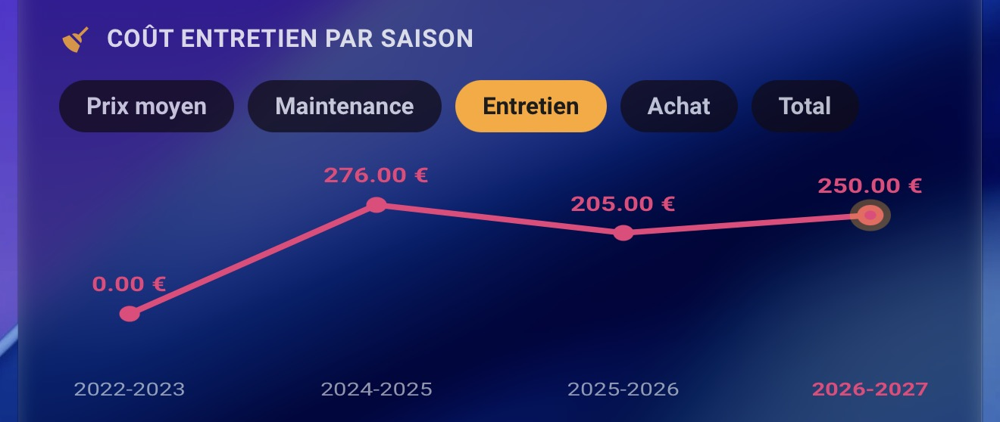
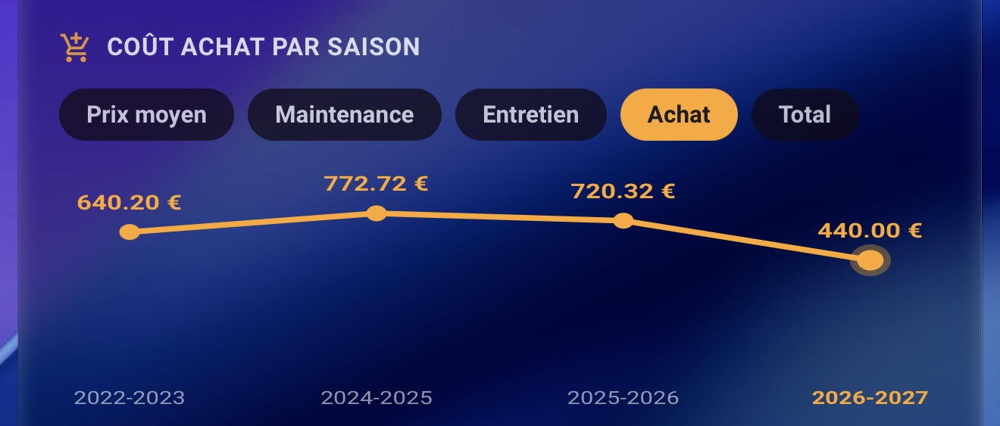
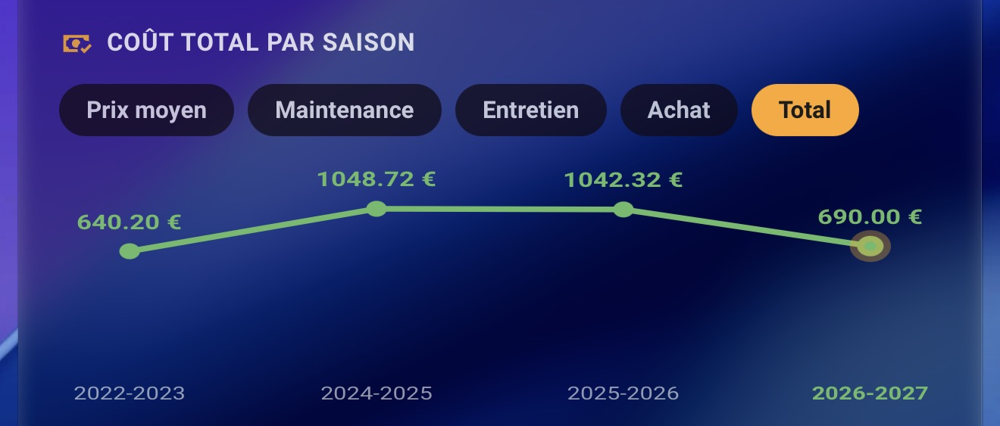
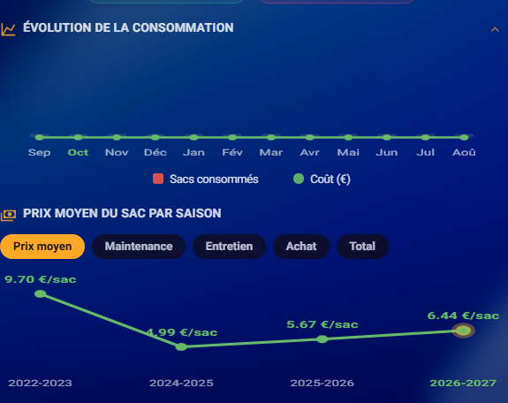
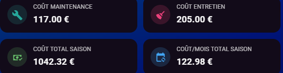

# Suivi Stock Pellet

[](https://github.com/hacs/integration)
[](https://github.com/cyclope205/suivi-stock-pellet/releases)
[](https://github.com/cyclope205/suivi-stock-pellet/actions/workflows/validate.yml)
[](https://github.com/cyclope205/suivi-stock-pellet/actions/workflows/tests.yml)
[](https://github.com/cyclope205/suivi-stock-pellet/issues)
[](LICENSE)
[](https://github.com/cyclope205/suivi-stock-pellet/releases)
[](https://github.com/cyclope205/suivi-stock-pellet/releases/latest)
[](https://github.com/cyclope205/suivi-stock-pellet/stargazers)
[](https://github.com/cyclope205/suivi-stock-pellet/network/members)

---

### ☕ Merci aux donateurs

<!--START_SECTION:paypal-->

<!--END_SECTION:paypal-->

<!--START_SECTION:buy-me-a-coffee-->
<!-- Les nouveaux dons seront ajoutés ici automatiquement -->
<!--END_SECTION:buy-me-a-coffee-->

### ❤️ Sponsors GitHub

<!--START_SECTION:github-sponsors-->
<!-- Aucun sponsor GitHub public actif pour le moment -->
<!--END_SECTION:github-sponsors-->

---

[](https://bmc-eight-red.vercel.app/api/donate?repo=suivi-stock-pellet) [](https://bmc-eight-red.vercel.app/api/paypal?repo=suivi-stock-pellet&amount=5)


### ☕ Offrez-moi un café pour m'aider à rester éveillé (et coder vos applications préférées)

En remerciement, votre nom apparaîtra (de façon anonymisée) dans la section « ☕ Merci aux donateurs » ci-dessus.

Intégration Home Assistant pour suivre le stock, la consommation et les achats de granulés de bois (pellets), avec une carte Lovelace clé en main.

## Sommaire

- [Captures d'écran](#captures-décran)
- [Fonctionnalités](#fonctionnalités)
- [Unités et prix (sacs / kg)](#unités-et-prix-sacs--kg)
- [Saisons de chauffe](#saisons-de-chauffe)
- [Import et export CSV](#import-et-export-csv)
- [Maintenance et entretien](#maintenance-et-entretien)
- [Carte Lovelace](#carte-lovelace)
- [Installation](#installation)
- [Utilisation](#utilisation)
- [Entités créées](#entités-créées)
- [Service `set_stock_initial`](#service-set_stock_initial)
- [Licence](#licence)

## Captures d'écran

---

Configuration de l'intégration — **Sacs** :


---

Configuration de l'intégration — **Kilogrammes (kg)** :


---

Import d'une ancienne saison par **CSV** :


---

Vue d'ensemble:


---

Sélecteur de saison:


---

Graphique quantité:


---

Configurateur de carte:


---

Calendrier des ajouts:


---

Vue d'ensemble de la carte v1.10.0 — suppression de saison, coûts maintenance/entretien :


---

Graphique de coût par saison (maintenance, entretien, achat, total) — un seul graphique à onglets :

| Prix moyen | Maintenance | Entretien |
|---|---|---|
|  |  |  |

| Achat | Total |
|---|---|
|  |  |

Bloc repliable (graphique mensuel, coût par saison, historique, calendrier) :

| Déplié | Replié |
|---|---|
|  |  |

---

## Fonctionnalités

- Suivi du stock en temps réel (kg et sacs), calculé à partir d'un journal d'achats/consommations — jamais de compteur qui dérive.
- Unité d'affichage au choix (**Sacs** ou **Kilogrammes**), propre à chaque intégration ; le poids de référence de 15 kg par sac reste fixe en interne.
- Capteur d'énergie consommée en kWh (`device_class: energy`), compatible avec le tableau de bord Énergie de Home Assistant.
- Suivi des dépenses (€) et du nombre de jours d'utilisation par saison de chauffe, avec tuiles de coût dérivées.
- Saisons de chauffe calculées automatiquement, historique conservé indéfiniment, consultable via le sélecteur de saison.
- Import d'anciennes saisons par CSV, et export CSV par saison/catégorie.
- Suivi des frais de maintenance et d'entretien du poêle, indépendamment du stock de granulés.
- Carte Lovelace intégrée, clé en main : tuiles, boutons d'ajout rapide, historique modifiable, calendrier, graphiques, comparaison à la saison précédente.
- Configurateur visuel (éditeur de carte intégré) pour activer/désactiver chaque section de la carte sans toucher au YAML.

## Unités et prix (sacs / kg)

L'unité d'affichage est choisie dans la **configuration de l'intégration** : **Sacs** (quantités et prix en sacs et €/sac) ou **Kilogrammes (kg)** (quantités et prix en kg et €/kg). Le choix est propre à chaque intégration et n'impacte pas une autre intégration existante. Le poids de référence de **15 kg par sac reste fixe en interne** et n'est pas demandé à l'utilisateur.

Le prix demandé dans la configuration dépend de l'unité choisie : **Prix moyen d'un sac (€)** en mode Sacs ou **Prix moyen au kg (€)** en mode kg. Le graphique de prix moyen par saison utilise la même unité, avec titre, valeurs et symbole €/sac ou €/kg synchronisés.

La tuile "Dépensé" s'appelle "Dépense pellet", pour la distinguer des coûts de maintenance et d'entretien, qui ne sont pas comptés dans le prix moyen du sac.

## Saisons de chauffe

- Les saisons sont calculées automatiquement à partir d'un **mois de début de saison** configurable (pas d'années codées en dur à ajouter chaque année). La fin de saison est automatiquement le mois précédent. Par exemple, avec septembre comme début, **septembre 2025 → août 2026 = saison 2025-2026**, et un achat de juillet 2026 appartient à cette saison. Ce mois ne peut plus être changé une fois que le journal contient des saisies, pour ne pas désynchroniser les saisons déjà enregistrées.
- Historique conservé indéfiniment : aucune saison n'est jamais supprimée ou écrasée au changement de saison. Un **sélecteur de saison** dans l'en-tête de la carte permet de consulter les tuiles, l'historique et les graphiques de n'importe quelle saison passée (les saisies restent verrouillées sur la saison en cours, sauf champ "Saison" explicite dans les formulaires).
- Les saisons sans aucune saisie sont automatiquement supprimées de la liste (au démarrage et dès qu'une saison redevient vide).
- Une saison entière peut être supprimée via le bouton poubelle à côté du sélecteur de saison, avec confirmation. Un avertissement s'affiche si une saison suivante existe déjà, car son stock initial (reporté de la saison supprimée) n'est pas recalculé automatiquement.
- Stock initial d'une saison repris automatiquement du stock restant de la saison précédente (dès la première saisie dans la nouvelle saison) ; corrigeable manuellement via le service [`set_stock_initial`](#service-set_stock_initial). **Ce report automatique ne s'applique qu'à la saisie manuelle au fil de l'eau — voir ci-dessous pour l'import CSV, qui ne reporte jamais de stock entre saisons.**
- Comparaison à date égale avec la saison précédente : consommation, coût en € et différence en € des deux saisons, avec badge en pourcentage (masquable via `show_comparison`).
- Modifier ou supprimer une saisie ne peut jamais faire passer le stock réel d'une saison sous 0 : ce cas est refusé avec un message d'erreur explicite.

## Import et export CSV

Le bouton **« Importer CSV »** (réservé aux administrateurs Home Assistant) permet de reconstituer une ancienne saison à partir d'un fichier CSV : le fichier est d'abord analysé et un aperçu s'affiche avant confirmation. Deux formats sont reconnus automatiquement :

- **Format "journal"** (recommandé, et celui généré par le bouton **« Exporter CSV »** de cette même intégration) : une ligne par saisie, avec un en-tête contenant au minimum une colonne `date`, une colonne contenant `type` et une colonne contenant `quantite` (une colonne prix et une colonne note sont optionnelles). Ce format est universel : il fonctionne quel que soit l'historique d'origine, dès lors que le fichier respecte cet en-tête.

  ```csv
  date,type,quantite,prix total
  2025-10-03,achat,3,19.5
  2025-10-15,consommation,1.8,
  ```

  La date accepte le format AAAA-MM-JJ ou un texte en français. La colonne `type` doit contenir « achat », « consommation », « maintenance » ou « entretien » pour être prise en compte.

- **Format "grille Excel historique"** : reconnaît un ancien tableau de suivi au format jour/mois en colonnes, avec un panneau latéral "Achats granules" / "Maintenance" / "Entretien". Ce format a été construit par rétro-ingénierie sur un tableur Excel personnel précis ; il repose sur des heuristiques (libellés exacts des marqueurs, disposition en grille) qui ne reconnaîtront pas forcément un historique Excel structuré différemment.

Dans les deux cas : la saison `AAAA-AAAA` est détectée automatiquement (ou déduite des dates pour le format journal), les nombres français et les montants en euros sont pris en charge, et les données restent stockées en sacs (affichables ensuite en sacs ou en kg). Les CSV vides ou invalides sont refusés avec une erreur explicite.

> **⚠️ Un fichier CSV ne peut contenir qu'une seule saison.** Contrairement à la saisie manuelle au fil de l'eau (qui reporte automatiquement le stock restant d'une saison sur la suivante, voir [Saisons de chauffe](#saisons-de-chauffe)), une saison créée par un **import** démarre toujours avec un stock de départ à **0**, sans aucun report depuis une saison précédente — même si cette saison précédente fait partie du même import. C'est volontaire et définitif : cela garantit qu'importer une saison donne toujours exactement le même résultat, qu'elle soit importée seule ou combinée avec d'autres saisons dans un seul fichier. Un fichier au format "journal" qui mélange plusieurs saisons (un export cumulé sur plusieurs années, par exemple) est donc **refusé dès l'analyse**, avec un message listant les saisons détectées : importez chaque saison séparément, un fichier CSV par saison. Si votre stock réel ne repart jamais à 0 d'une saison à l'autre, cette limite ne peut pas être levée côté import ; utilisez le service [`set_stock_initial`](#service-set_stock_initial) après l'import pour corriger manuellement le stock de départ de chaque saison concernée.

Le bouton **« Exporter CSV »** ouvre une fenêtre de sélection : cocher une ou plusieurs saisons et une ou plusieurs catégories (Achat / Consommation / Maintenance / Entretien), puis télécharger un CSV fusionné au format "journal" ci-dessus (`Saison;Date;Type;Quantite;Prix par sac;Prix total;Note`). Pour pouvoir le réimporter, veillez à ne cocher qu'une seule saison à la fois lors de l'export.

> **En cas d'échec de l'import** (fichier refusé, erreur inattendue...), merci d'ouvrir une issue sur le dépôt avec le détail de l'erreur et, si possible, un extrait du fichier CSV concerné : [ouvrir une issue](https://github.com/cyclope205/suivi-stock-pellet/issues/new).

## Maintenance et entretien

Suivi des frais de maintenance et d'entretien du poêle, indépendamment du stock de granulés : deux boutons dédiés ("Maintenance" / "Entretien") ouvrent chacun un formulaire (coût, date, note libre) utilisable même sur une saison passée via le champ saison. Ces saisies apparaissent dans l'historique avec leur note, dans le calendrier avec une couleur dédiée par type, et alimentent deux tuiles ("Coût maintenance", "Coût entretien") ainsi que deux courbes "par saison" masquables.

## Carte Lovelace

Carte Lovelace intégrée (`custom:suivi-stock-pellet-card`), servie automatiquement par l'intégration (aucune ressource à ajouter manuellement) :

- Stock en un coup d'œil, boutons "+ Consommation" / "+ Achat", bouton rapide d'ajout (quantité configurable, "+1 sac aujourd'hui" par défaut, visible uniquement sur la saison en cours), annulation de la dernière saisie.
- Historique des dernières entrées, modifiable (crayon) et supprimable (corbeille, avec confirmation).
- Les formulaires Achat/Consommation acceptent une date libre (passée ou future), ce qui permet de reconstruire une saison passée entièrement après coup ; ils incluent un champ "Saison" optionnel pour rattacher la saisie à une saison différente de celle déduite de la date, et le formulaire Achat propose un champ "prix total du bon de livraison" en alternative au prix par sac.
- Graphique "Évolution de la consommation" avec deux courbes superposables (sacs consommés / coût en €) et boutons pour n'afficher que l'une des deux ; sa valeur mensuelle s'affiche directement sur le graphique quand une seule courbe est visible.
- Graphique de coût par saison à onglets (Prix moyen / Maintenance / Entretien / Achat / Total).
- Section calendrier (navigable mois par mois) : chaque jour affiche les achats et consommations enregistrés, avec une couleur différente selon le type ; mise à jour immédiate après ajout, suppression ou modification.
- Titre "Évolution de la consommation" cliquable : replie ou déplie tout le bas de la carte (graphique mensuel, coût par saison, historique, calendrier) ; pratique sur un tableau de bord en vue portrait. L'état plié/déplié est mémorisé dans le navigateur.
- Configurateur visuel (éditeur de carte intégré) pour activer/désactiver chaque section sans toucher au YAML.
- Tuiles, historique, calendrier et graphiques visibles pour tous les utilisateurs du tableau de bord ; seules les actions d'écriture (saisie, modification, suppression) sont réservées à un accès normal.

Le bouton **« +1 sac aujourd'hui »** peut aussi être déclenché sans passer par la carte, via le service `suivi_stock_pellet.log_consumption` (ex. `qty_bags: 1`) depuis n'importe quelle automatisation.

## Installation

### Via HACS

1. Ouvrir le dépôt dans HACS et l'installer :
   [](https://my.home-assistant.io/redirect/hacs_repository/?owner=cyclope205&repository=suivi-stock-pellet&category=integration)
   ou rechercher "Suivi Stock Pellet" dans HACS.
2. Redémarrer Home Assistant.
3. Ajouter l'intégration :
   [](https://my.home-assistant.io/redirect/config_flow_start/?domain=suivi_stock_pellet)
   ou Paramètres → Appareils et services → Ajouter une intégration → rechercher "Suivi Stock Pellet".

**⚠️ La carte affiche « Erreur de configuration : Custom element doesn't exist: suivi-stock-pellet-card » juste après l'installation ?** C'est normal, le temps que le navigateur recharge le cache : faites **Ctrl+F5** sur navigateur (rechargement forcé), ou **fermez complètement puis relancez l'application Home Assistant Companion** sur mobile. La carte s'affiche ensuite normalement.

### Ajouter la carte au tableau de bord

Une fois l'intégration installée (étapes ci-dessus), la carte doit être ajoutée manuellement à votre tableau de bord :

1. Ouvrez le tableau de bord concerné et cliquez sur le crayon en haut à droite pour passer en mode édition.
2. Cliquez sur "+ Ajouter une carte" en bas de l'écran.
3. Dans la barre de recherche, tapez "Suivi Stock Pellet" : la carte apparaît dans la liste, cliquez dessus puis sur "Enregistrer".

Alternative en YAML (onglet "Modifier en YAML" de la fenêtre d'ajout de carte) :

```yaml
type: custom:suivi-stock-pellet-card
```

### Configuration

À l'ajout de l'intégration :

| Paramètre | Description | Défaut |
|---|---|---|
| Unité d'affichage | Affichage des quantités et des prix en sacs ou en kilogrammes | Sacs |
| Prix moyen d'un sac (€) | Affiché et utilisé lorsque l'unité **Sacs** est sélectionnée | 6,50 € |
| Prix moyen au kg (€) | Affiché et utilisé lorsque l'unité **Kilogrammes (kg)** est sélectionnée | 0,43 € |
| Pouvoir calorifique | kWh par kg de granulés, pour le calcul énergie | 4,8 |
| Mois de début de saison | Mois à partir duquel une nouvelle saison de chauffe commence. La fin de saison est automatiquement le mois précédent | 9 (septembre) |
| Quantité de sacs par défaut (bouton rapide) | Nombre de sacs ajoutés en un clic par le bouton rapide de la carte | 1 |

> Le poids de référence de **15 kg par sac est fixe en interne** et n'est pas demandé dans la configuration.

Ces valeurs sont modifiables ensuite via **Configurer** sur l'intégration. Le champ de prix proposé dépend de l'unité d'affichage choisie.

## Utilisation

Ajoute la carte à un tableau de bord :

```yaml
type: custom:suivi-stock-pellet-card
```

Options de configuration de la carte (toutes optionnelles, tout est affiché par défaut — modifiables aussi via le configurateur visuel) :

| Option | Description |
|---|---|
| `show_stats` | Tuiles consommé / énergie / dépensé / jours |
| `show_cost_stats` | Tuiles coût / jour CONSO, coût / mois CONSO, coût du sac, coût total saison, coût/mois total saison |
| `show_actions` | Boutons et formulaires de saisie (Consommation, Achat, Maintenance, Entretien, bouton rapide) |
| `show_secondary_actions` | Masque ensemble les boutons et formulaires Achat, Maintenance et Entretien (Consommation et le bouton rapide restent toujours visibles) : pratique si vous ne vous en servez que rarement, par exemple une fois par an pour Maintenance/Entretien |
| `show_csv_import` | Boutons "Importer CSV" et "Exporter CSV" (import réservé aux administrateurs Home Assistant) |
| `show_monthly_chart` | Graphique "Évolution de la consommation" (quantité / coût) |
| `show_price_chart` | Onglet "Prix moyen" du graphique de coût par saison |
| `show_maintenance_chart` | Onglet "Maintenance" du graphique de coût par saison |
| `show_entretien_chart` | Onglet "Entretien" du graphique de coût par saison |
| `show_achat_chart` | Onglet "Achat" du graphique de coût par saison |
| `show_cost_total_chart` | Onglet "Total" du graphique de coût par saison (achat + maintenance + entretien) |
| `show_history` | Liste des dernières saisies |
| `show_calendar` | Calendrier des ajouts, navigable mois par mois |
| `show_comparison` | Comparaison avec la saison précédente à date égale |

Les tuiles de coût existent en deux versions, à ne pas confondre : "Coût / jour CONSO" et "Coût / mois CONSO" reflètent uniquement la valeur des granulés réellement consommés (prix moyen × quantité consommée), tandis que "Coût total saison" et "Coût/mois total saison" couvrent toute la dépense de la saison (achats + maintenance + entretien), y compris du stock pas encore brûlé. Le second peut donc paraître élevé par rapport au premier, notamment en début de saison ou après un gros achat ou un entretien ponctuel.



Les options `show_price_chart`, `show_maintenance_chart`, `show_entretien_chart`, `show_achat_chart` et `show_cost_total_chart` contrôlent chacune un onglet d'un même graphique de coût par saison (un seul graphique affiché à la fois, avec des onglets pour basculer entre Prix moyen / Maintenance / Entretien / Achat / Total). Décocher une option retire simplement son onglet ; si un seul onglet reste, il s'affiche seul et sans navigation.

### Services

- `suivi_stock_pellet.log_consumption` (`qty_bags`, `season` facultative, `date` facultative)
- `suivi_stock_pellet.log_purchase` (`qty_bags`, `season` facultative, `price_eur` facultatif — utilise le prix moyen actuel si absent, `date` facultative)
- `suivi_stock_pellet.undo_last_entry`
- `suivi_stock_pellet.edit_entry` (`season`, `index`, champs à modifier)
- `suivi_stock_pellet.delete_entry` (`season`, `index`)
- `suivi_stock_pellet.set_stock_initial` (`season`, `stock_initial_bags`) — définit ou corrige le stock de départ d'une saison, voir [chapitre dédié](#service-set_stock_initial)
- `suivi_stock_pellet.delete_season` (`season`) — supprime entièrement une saison (toutes ses saisies)
- `suivi_stock_pellet.log_maintenance` (`price_eur`, `season` facultative, `date` facultative, `note` facultative) — enregistre un coût de maintenance
- `suivi_stock_pellet.log_entretien` (`price_eur`, `season` facultative, `date` facultative, `note` facultative) — enregistre un coût d'entretien
- `suivi_stock_pellet.export_csv` (`season` facultative — toutes les saisons si absente, `date_from`/`date_to` facultatives, `types` facultatif) — génère un CSV au format "journal" (utilisé en interne par le bouton "Exporter CSV")

## Entités créées

- `sensor.*_stock` — stock actuel (kg), avec le nombre de sacs et la saison en attributs
- `sensor.*_consomme_kg` — consommé cette saison (kg)
- `sensor.*_consomme_kwh` — énergie consommée cette saison (kWh, tableau de bord Énergie)
- `sensor.*_achete_kg` — acheté cette saison (kg)
- `sensor.*_depense` — dépensé cette saison (€)
- `sensor.*_jours_utilisation` — nombre de jours de consommation enregistrés

## Service `set_stock_initial`

Pour corriger manuellement le stock de départ d'une saison (comptage physique, saison déjà entamée avant l'ajout du report automatique, ou saison importée par CSV dont le stock réel ne repartait pas de 0...), en plus du report automatique décrit plus haut :

| Paramètre | Description |
|---|---|
| `season` | Saison à corriger, au format AAAA-AAAA (ex. 2024-2025). |
| `unit` | `bag` (sacs, par défaut) ou `kg` (vrac). |
| `stock_initial_bags` | Nombre de sacs présents au début de la saison (si `unit: bag`). |
| `stock_initial_kg` | Quantité en kg présente au début de la saison (si `unit: kg`). |

```yaml
action: suivi_stock_pellet.set_stock_initial
data:
  season: "2024-2025"
  stock_initial_bags: 12
```

```yaml
action: suivi_stock_pellet.set_stock_initial
data:
  season: "2024-2025"
  unit: kg
  stock_initial_kg: 180
```

## Licence

MIT — voir [LICENSE](LICENSE).
